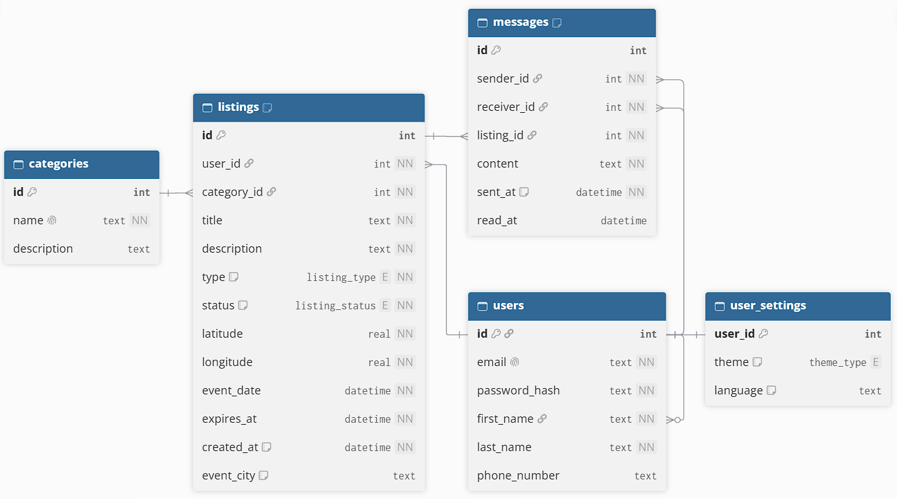

## Schemat bazy danych



```
[Users]
	Id PK
	Email UNIQUE
	PasswordHash
	FirstName
	LastName
	PhoneNumber NULLABLE

[Listings]
	Id PK
	UserId FK(Users.Id)
	CategoryId FK(Categories.Id)
	Title
	Description
	Type CON("Lost" || "FOUND)
	Status CON("Active", "Resolved", "Closed")
	Latitude
	Longitude
	EventDate
	ExpiresAt
	CreatedAt
-MOŻE-	EventCity NULLABLE (gdzie zgubiono, nazwa moze do zmiany)
	

[Categories]
	Id PK
	Name UNIQUE
	Description NULLABLE

[Messages]
	Id PK
	SenderId FK(Users.Id)
	ReceiverId FK(Users.Id)
	ListingId FK(Listings.Id)
	Content
	SentAt
	ReadAt NULLABLE

[UserSettings]
	UserId PK, FK(Users.Id)
 -MOŻE-	theme CON(1,2,3) -- czy cos w tym stylu
 -MOŻE- Language DEFAULT("PL")
```
